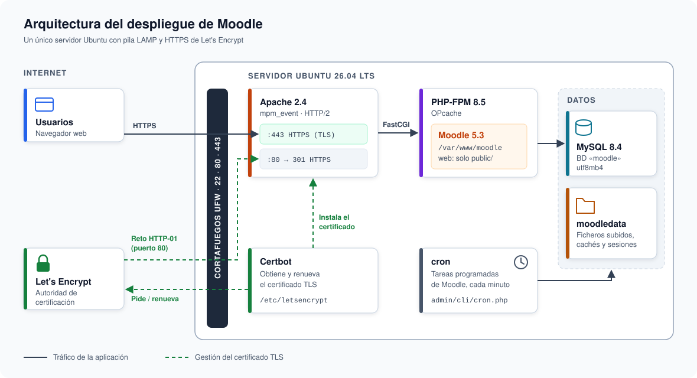

# Despliegue de Moodle con Bash y plantillas

Scripts didácticos para instalar la **última versión estable de Moodle** en un
servidor Ubuntu con la pila **LAMP** (Linux, Apache, MySQL, PHP) y **HTTPS**
mediante un certificado gratuito de **Let's Encrypt**.

El objetivo es doble:

1. **Desplegar** un Moodle funcional siguiendo las buenas prácticas.
2. **Aprender** qué hace cada paso: los scripts están divididos en pasos
   numerados y comentados, y muestran cada orden antes de ejecutarla.

---

## Índice

1. [Cómo funciona](#1-cómo-funciona)
2. [Requisitos](#2-requisitos)
3. [Estructura del proyecto](#3-estructura-del-proyecto)
4. [Configuración (`.env`)](#4-configuración-env)
5. [Despliegue paso a paso](#5-despliegue-paso-a-paso)
6. [Plantillas de configuración](#6-plantillas-de-configuración)
7. [Comprobar que todo funciona](#7-comprobar-que-todo-funciona)
8. [Dónde queda cada cosa](#8-dónde-queda-cada-cosa)
9. [Solución de problemas](#9-solución-de-problemas)
10. [Buenas prácticas aplicadas](#10-buenas-prácticas-aplicadas)
11. [Limitaciones y siguientes pasos](#11-limitaciones-y-siguientes-pasos)
12. [Glosario](#12-glosario)

---

## 1. Cómo funciona



Recorrido de una petición:

1. El **navegador** se conecta por HTTPS (puerto 443).
2. El **cortafuegos** (UFW) solo deja pasar los puertos 22, 80 y 443.
3. **Apache** descifra la conexión con el certificado TLS. Si alguien entra
   por HTTP (puerto 80), lo redirige a HTTPS.
4. Apache pasa las peticiones PHP a **PHP-FPM**, donde se ejecuta **Moodle**.
5. Moodle lee y guarda la información en **MySQL** y los ficheros en
   **moodledata**.

En segundo plano, **cron** lanza cada minuto las tareas programadas de Moodle,
y **Certbot** renueva el certificado con **Let's Encrypt** antes de que caduque.

Los tres scripts se ejecutan **en este orden**:

| # | Script | Qué hace |
|---|---|---|
| 1 | `01-install-lamp.sh` | Instala y configura Apache, PHP-FPM, MySQL, Composer y el cortafuegos |
| 2 | `02-setup-letsencrypt.sh` | Crea el sitio web en Apache y obtiene el certificado TLS (HTTPS) |
| 3 | `03-deploy-moodle.sh` | Descarga Moodle, crea la base de datos y lo instala con su instalador CLI |

> **¿Por qué el certificado va antes que Moodle?**
> Moodle guarda su URL (`wwwroot`) al instalarse. Si HTTPS ya funciona en ese
> momento, se instala directamente con `https://` y no hay que cambiar nada
> después.

---

## 2. Requisitos

**Servidor**

- **Ubuntu Server 26.04 LTS** o posterior. Moodle 5.3 necesita PHP ≥ 8.3 y
  MySQL ≥ 8.4, y Ubuntu 26.04 los trae en sus repositorios (PHP 8.5 y
  MySQL 8.4). Ubuntu 24.04 LTS trae MySQL 8.0, que no es suficiente.
- Al menos **2 GB de RAM** y **10 GB de disco libres**.
- Un usuario con permisos de `sudo`.
- Acceso a Internet: se descargan paquetes, Moodle y sus librerías.

**Red y DNS**

- Un **nombre de dominio** cuyo registro DNS (tipo `A`) apunte a la **IP
  pública** del servidor.
- Puertos abiertos hacia el servidor:

  | Puerto | Uso |
  |---|---|
  | 22/tcp | SSH, para administrar el servidor |
  | 80/tcp | HTTP: Let's Encrypt valida el dominio por este puerto |
  | 443/tcp | HTTPS: acceso a Moodle |

  En la nube (AWS, Azure, GCP...) hay que abrirlos **también** en el
  cortafuegos del proveedor (por ejemplo, el *Security Group* de AWS). El
  script 01 configura el cortafuegos interno del servidor (UFW), pero no puede
  tocar el del proveedor.

Para comprobar el DNS desde el servidor:

```bash
curl -s https://checkip.amazonaws.com     # IP pública del servidor
getent hosts moodle.example.com           # IP a la que apunta el dominio
```

Las dos deben coincidir.

---

## 3. Estructura del proyecto

| Ruta | Contenido |
|---|---|
| `.env.example` | Plantilla de variables (se copia a `.env`) |
| `.env` | Tus valores reales. **No se comparte** |
| `01-install-lamp.sh` | Paso 1: pila LAMP |
| `02-setup-letsencrypt.sh` | Paso 2: Apache + certificado TLS |
| `03-deploy-moodle.sh` | Paso 3: instalación de Moodle |
| `templates/apache/moodle.conf` | Sitio web (VirtualHost) de Moodle |
| `templates/apache/security.conf` | Endurecimiento de Apache |
| `templates/php/99-moodle.ini` | Ajustes de PHP para Moodle |
| `templates/mysql/create-moodle-db.sql` | Base de datos y usuario |
| `templates/cron/moodle` | Tarea programada de Moodle |
| `docs/img/` | Imágenes de esta documentación |

La idea es **separar la lógica de la configuración**:

- Los **scripts** dicen *qué pasos* se dan y en qué orden.
- Las **plantillas** dicen *cómo* queda configurado cada servicio.
- El **`.env`** contiene los *datos propios* de cada instalación (dominio,
  contraseñas...).

Así puedes desplegar otro Moodle cambiando solo el `.env`, o ajustar la
configuración de PHP editando solo su plantilla.

---

## 4. Configuración (`.env`)

```bash
cp .env.example .env
chmod 600 .env     # contiene contraseñas: solo su dueño puede leerlo
nano .env
```

| Variable | Ejemplo | Para qué sirve |
|---|---|---|
| `DOMAIN` | `moodle.example.com` | Dominio del sitio |
| `LE_EMAIL` | `admin@example.com` | Email para los avisos de caducidad del certificado |
| `DB_NAME` | `moodle` | Nombre de la base de datos |
| `DB_USER` | `moodle` | Usuario de MySQL que usará Moodle |
| `DB_PASS` | *(aleatoria)* | Su contraseña: solo letras y números |
| `MOODLE_SITE_FULLNAME` | `"Campus Virtual"` | Nombre completo del sitio |
| `MOODLE_SITE_SHORTNAME` | `Campus` | Nombre corto del sitio |
| `MOODLE_LANG` | `es` | Idioma de instalación (`es`, `en`, `ca`, `gl`, `eu`...) |
| `MOODLE_ADMIN_USER` | `admin` | Usuario administrador de Moodle |
| `MOODLE_ADMIN_PASS` | *(aleatoria)* | Al menos 8 caracteres, con mayúscula, minúscula, número y símbolo |
| `MOODLE_ADMIN_EMAIL` | `admin@example.com` | Email del administrador |

**Cómo generar contraseñas seguras:**

```bash
openssl rand -base64 24 | tr -dc 'A-Za-z0-9'; echo           # para DB_PASS
echo "$(openssl rand -base64 18 | tr -dc 'A-Za-z0-9')Aa1#"   # para MOODLE_ADMIN_PASS
```

> **Comillas:** si un valor tiene espacios o símbolos, escríbelo entre
> comillas simples: `MOODLE_ADMIN_PASS='Abc123#xyz'`.

> **Nunca subas el `.env` a un repositorio.** Comparte solo `.env.example`.

**¿Por qué tan pocas variables?** Solo están en el `.env` los datos que
*cambian* de una instalación a otra. Las rutas estándar (`/var/www/moodle` y
`/var/moodledata`) y los ajustes recomendados están fijados en los scripts y en
las plantillas.

---

## 5. Despliegue paso a paso

```bash
cd ruta/al/proyecto
sudo ./01-install-lamp.sh
sudo ./02-setup-letsencrypt.sh
sudo ./03-deploy-moodle.sh
```

Los scripts muestran cada orden precedida de `+` antes de ejecutarla, salvo las
que llevan contraseñas. Si una orden falla, el script se detiene en ese punto.

### Paso 1: Pila LAMP (`01-install-lamp.sh`)

1. Actualiza el sistema (`apt-get update && apt-get upgrade`).
2. Instala **Apache**.
3. Instala **PHP-FPM** y las extensiones que exige Moodle, y además
   **Composer**, el gestor de librerías PHP.
4. Conecta Apache con PHP-FPM (módulos `mpm_event` y `proxy_fcgi`).
5. Copia los **ajustes de PHP** (`templates/php/99-moodle.ini`).
6. Instala **MySQL**.
7. Instala herramientas que Moodle usa opcionalmente: ghostscript (PDF),
   graphviz (gráficos) y aspell (corrector ortográfico).
8. Aplica el **endurecimiento de Apache** (`templates/apache/security.conf`).
9. Activa el **cortafuegos UFW**: solo SSH, HTTP y HTTPS.
10. Reinicia los servicios y los habilita para que arranquen con el sistema.

### Paso 2: HTTPS (`02-setup-letsencrypt.sh`)

1. Lee el `.env` y comprueba que no falten variables.
2. Comprueba que el **dominio apunta a este servidor**.
3. Crea el **VirtualHost** de Apache a partir de `templates/apache/moodle.conf`.
4. Instala **Certbot**, el cliente oficial de Let's Encrypt, mediante `snap`.
5. Pide el **certificado**. Certbot, además:
   - crea el VirtualHost HTTPS (`moodle-le-ssl.conf`);
   - redirige HTTP → HTTPS (`--redirect`);
   - activa HSTS (`--hsts`), que indica al navegador que use siempre HTTPS.
6. Simula una **renovación** (`certbot renew --dry-run`) para comprobar que la
   renovación automática funcionará.

> **¿Cómo valida Let's Encrypt el dominio?** (reto *HTTP-01*)
> Certbot deja un fichero temporal en el servidor y Let's Encrypt intenta
> descargarlo desde `http://<dominio>/.well-known/acme-challenge/...`. Si lo
> consigue, queda demostrado que controlas el dominio. Por eso el puerto 80
> debe estar abierto.

### Paso 3: Moodle (`03-deploy-moodle.sh`)

1. Lee el `.env`. **Si Moodle ya está instalado** (existe `config.php`), no
   hace nada.
2. Averigua la **última versión estable** consultando las ramas
   `MOODLE_XYZ_STABLE` de GitHub (`503` = Moodle 5.3).
3. **Descarga** el paquete oficial y comprueba su **suma SHA-256**, para
   asegurarse de que no está dañado ni manipulado.
4. Lo **descomprime** en `/var/www/moodle`.
5. Instala sus **librerías PHP con Composer** (`--no-dev`: sin herramientas de
   desarrollo).
6. Crea la **base de datos y su usuario** (`templates/mysql/create-moodle-db.sql`).
7. Crea el **directorio de datos** `/var/moodledata`.
8. Ajusta los **permisos**: el código pertenece a `root`.
9. **Instala Moodle con su instalador CLI** (`admin/cli/install.php`). Crea
   las tablas, la cuenta de administrador y el fichero `config.php`.
10. Completa `config.php` (`routerconfigured`) y lo protege con permisos `640`.
11. Programa el **cron** de Moodle (`templates/cron/moodle`).
12. Recarga PHP-FPM para limpiar la caché de código.

> **¿Por qué el instalador CLI?** Instalar desde el navegador obliga a
> rellenar formularios a mano. El instalador de línea de comandos recibe todos
> los datos como parámetros (`--non-interactive`), así que la instalación se
> puede **automatizar y repetir** siempre igual.

---

## 6. Plantillas de configuración

Los scripts **no escriben configuración dentro del código**: la toman del
directorio `templates/`, de una de estas dos formas.

**a) Copia directa**, cuando la plantilla no tiene variables:

```bash
install -m 644 templates/php/99-moodle.ini /etc/php/8.5/fpm/conf.d/99-moodle.ini
```

`install -m 644` copia el fichero y le da los permisos indicados (lectura y
escritura para root, solo lectura para los demás) en una sola orden.

**b) Sustitución de variables con `envsubst`**, cuando la plantilla contiene
valores que dependen del `.env`:

```apache
# templates/apache/moodle.conf (fragmento)
ServerName ${DOMAIN}
DocumentRoot ${MOODLE_DIR}/public
```

```bash
export DOMAIN=moodle.example.com MOODLE_DIR=/var/www/moodle
envsubst '${DOMAIN} ${MOODLE_DIR}' < templates/apache/moodle.conf \
                                    > /etc/apache2/sites-available/moodle.conf
```

```apache
# Resultado
ServerName moodle.example.com
DocumentRoot /var/www/moodle/public
```

Detalles importantes:

- `envsubst` solo ve variables **exportadas** (`export`).
- Conviene indicar **qué variables sustituir** (`'${DOMAIN} ${MOODLE_DIR}'`).
  Si no, sustituiría todas, incluida `${APACHE_LOG_DIR}`, que es de Apache y
  debe llegarle intacta.

| Plantilla | Método | Destino | Script |
|---|---|---|---|
| `php/99-moodle.ini` | copia | `/etc/php/<versión>/{fpm,cli}/conf.d/` | 01 |
| `apache/security.conf` | copia | `/etc/apache2/conf-available/` | 01 |
| `apache/moodle.conf` | `envsubst` | `/etc/apache2/sites-available/` | 02 |
| `mysql/create-moodle-db.sql` | `envsubst` → `mysql` | (se ejecuta, no se guarda) | 03 |
| `cron/moodle` | `envsubst` | `/etc/cron.d/` | 03 |

**Para cambiar un ajuste**, edita la plantilla y vuelve a ejecutar el script
correspondiente. Por ejemplo, para permitir subidas de 500 MB, cambia
`upload_max_filesize` y `post_max_size` en `templates/php/99-moodle.ini` y
ejecuta de nuevo `01-install-lamp.sh`.

---

## 7. Comprobar que todo funciona

```bash
# Servicios activos
systemctl status apache2 mysql php*-fpm --no-pager

# Moodle responde por HTTPS (debe devolver 200 o 303)
curl -sI https://moodle.example.com | head -1

# HTTP redirige a HTTPS (debe devolver 301)
curl -sI http://moodle.example.com | head -1

# Comprobaciones de entorno y seguridad del propio Moodle
sudo -u www-data php /var/www/moodle/admin/cli/checks.php

# Certificado y fecha de caducidad
sudo certbot certificates

# Temporizador de renovación automática
systemctl list-timers | grep certbot

# El cron de Moodle se ejecuta sin errores
sudo -u www-data php /var/www/moodle/admin/cli/cron.php
```

Después, entra en `https://<tu-dominio>` con el usuario administrador y
revisa **Administración del sitio → Notificaciones**.

---

## 8. Dónde queda cada cosa

| Elemento | Ruta |
|---|---|
| Código de Moodle | `/var/www/moodle` (la web solo ve `/var/www/moodle/public`) |
| Configuración de Moodle | `/var/www/moodle/config.php` |
| Datos de Moodle (ficheros, cachés...) | `/var/moodledata` |
| Sitio de Apache (HTTP) | `/etc/apache2/sites-available/moodle.conf` |
| Sitio de Apache (HTTPS) | `/etc/apache2/sites-available/moodle-le-ssl.conf` |
| Logs de Apache | `/var/log/apache2/moodle-error.log`, `moodle-access.log` |
| Ajustes de PHP | `/etc/php/<versión>/{fpm,cli}/conf.d/99-moodle.ini` |
| Certificados | `/etc/letsencrypt/live/<dominio>/` |
| Logs de Certbot | `/var/log/letsencrypt/letsencrypt.log` |
| Cron de Moodle | `/etc/cron.d/moodle` |

---

## 9. Solución de problemas

| Síntoma | Causa probable | Qué hacer |
|---|---|---|
| `ERROR: la variable X está vacía` | Falta un valor en `.env` | Rellénalo y vuelve a ejecutar |
| `ERROR: <dominio> apunta a ... pero la IP es ...` | El DNS no apunta al servidor o aún no se ha propagado | Corrige el registro `A` y espera unos minutos |
| Certbot: `Timeout during connect` | El puerto 80 está cerrado | Ábrelo en el cortafuegos del proveedor y en UFW (`sudo ufw status`) |
| Certbot: `too many certificates` | Has alcanzado el límite de peticiones de Let's Encrypt | Espera o prueba primero con `--staging` |
| El instalador falla por la contraseña | `MOODLE_ADMIN_PASS` no cumple la política | Mayúscula, minúscula, número y símbolo, mínimo 8 caracteres |
| El instalador dice que la base de datos ya tiene tablas | Instalación anterior a medias | Ver "Empezar de cero" más abajo |
| Error 500 o página en blanco | Error de PHP | `sudo tail -f /var/log/apache2/moodle-error.log` |
| Aviso en Moodle: *cron no se ha ejecutado* | El cron no funciona | `cat /etc/cron.d/moodle` y ejecuta `cron.php` a mano (sección 7) |

### Empezar de cero

> ⚠️ **Esto borra Moodle y todos sus datos.** Úsalo solo en instalaciones de
> prueba.

```bash
sudo rm -f  /etc/cron.d/moodle
sudo rm -rf /var/www/moodle /var/moodledata
sudo mysql -e "DROP DATABASE IF EXISTS moodle; DROP USER IF EXISTS 'moodle'@'localhost';"
sudo ./03-deploy-moodle.sh
```

---

## 10. Buenas prácticas aplicadas

**Scripts**

- `set -euo pipefail`: el script se detiene ante cualquier error o variable
  no definida, en lugar de seguir con un estado inconsistente.
- `set -x` (traza): muestra cada orden antes de ejecutarla. Se desactiva
  cuando una orden lleva contraseñas.
- Configuración en **plantillas** y datos propios de cada instalación en el
  **`.env`**, separados de la lógica.
- Comprobaciones previas (variables, DNS, instalación existente) antes de
  modificar nada.

**Seguridad**

- **Código propiedad de `root`**: el servidor web solo puede leerlo. Si se
  explotara un fallo de Moodle, el atacante no podría modificar el código.
- **`moodledata` fuera de la carpeta web**: los ficheros subidos no son
  descargables directamente.
- **`config.php` con permisos `640`**: contiene la contraseña de la base de datos.
- **Paquete verificado** con SHA-256 antes de instalarlo.
- **Usuario de MySQL con privilegios mínimos**: solo sobre su base de datos.
- **Reglas de Apache** que bloquean ficheros internos (`composer.json`,
  `.git`, `vendor/`...).
- **Apache no revela su versión** (`ServerTokens Prod`).
- **HTTPS obligatorio**: redirección desde HTTP, HSTS y renovación automática.
- **Cortafuegos** abierto solo a lo imprescindible.

**Rendimiento**

- **PHP-FPM + `mpm_event`** en lugar de `mod_php`: menos memoria y más
  peticiones simultáneas.
- **OPcache** activado: el código PHP compilado se guarda en memoria.
- **Composer** con `--classmap-authoritative`: carga de clases optimizada.

**Moodle**

- **Estructura de Moodle ≥ 5.1**: solo `public/` es accesible desde la web, y
  el *router* está configurado (`FallbackResource /r.php` +
  `$CFG->routerconfigured`).
- **Base de datos en `utf8mb4`**: admite todos los caracteres, incluidos los emojis.
- `max_input_vars = 5000`, el valor que exige Moodle.
- **Cron cada minuto**, como recomienda Moodle.

---

## 11. Limitaciones y siguientes pasos

Estos scripts cubren la **instalación inicial en un único servidor**. Para un
servicio en producción, faltaría:

- **Copias de seguridad** programadas de la base de datos (`mysqldump`) y de
  `/var/moodledata`, guardadas fuera del servidor.
- **Actualizaciones de Moodle**: modo mantenimiento, copia de seguridad, nuevo
  código y `admin/cli/upgrade.php`.
- **Correo saliente (SMTP)**, para que Moodle pueda enviar notificaciones.
- **Monitorización** del servidor y de los logs.
- **Caché con Redis** y **antivirus (ClamAV)** para sitios con muchos usuarios.

Cuando haya varios servidores o entornos (pruebas, producción), conviene
pasar a una herramienta de gestión de configuración como **Ansible**. Sus
conceptos se corresponden casi uno a uno con los de este proyecto:

| Este proyecto | Ansible |
|---|---|
| `.env` | Variables de inventario + Ansible Vault (cifrado) |
| `templates/` + `envsubst` | Plantillas Jinja2 + módulo `template` |
| Pasos numerados del script | Tareas de un *playbook* |
| `systemctl restart` | *Handlers*: solo reinician si algo cambió |

---

## 12. Glosario

| Término | Significado |
|---|---|
| **LAMP** | Linux + Apache + MySQL + PHP: la pila clásica para aplicaciones web en PHP |
| **VirtualHost** | Configuración de Apache para un sitio concreto (un dominio) |
| **DocumentRoot** | Carpeta que Apache publica en la web |
| **PHP-FPM** | Servicio que ejecuta PHP por separado de Apache |
| **OPcache** | Caché de PHP que guarda el código ya compilado |
| **Composer** | Gestor de librerías (dependencias) de PHP |
| **TLS / HTTPS** | Cifrado de la comunicación entre navegador y servidor |
| **Let's Encrypt** | Autoridad que emite certificados TLS gratuitos y automáticos |
| **Certbot** | Programa que pide y renueva los certificados de Let's Encrypt |
| **HSTS** | Cabecera que obliga al navegador a usar siempre HTTPS con ese dominio |
| **UFW** | *Uncomplicated Firewall*, el cortafuegos sencillo de Ubuntu |
| **cron** | Servicio de Linux que ejecuta tareas programadas |
| **`moodledata`** | Directorio donde Moodle guarda ficheros subidos, cachés y sesiones |
| **`wwwroot`** | URL pública del sitio, guardada en `config.php` |
| **CLI** | *Command Line Interface*: uso desde la terminal en vez del navegador |
| **`envsubst`** | Orden que sustituye `${VARIABLES}` de un texto por sus valores |
